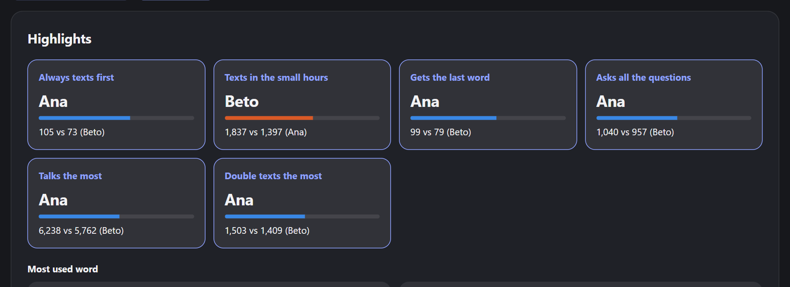

# 📊 Chat Stats

Find out who really carries the conversation. Drop a Telegram or WhatsApp export and get stats per
person: who texts first, who replies fastest, who leaves you on read.

**Your chat never leaves your device.** There is no backend, no account and no analytics.

**[Open Chat Stats →](https://tletelieru.github.io/chat-stats/)**



_Screenshot made with an invented chat._

## What you get

- **Highlights:** head-to-head cards like "Always texts first" and "Replies the fastest", plus each
  person's most used word, phrase, emoji, keyboard face and shouted word
- **Conversations:** who starts, who ends, double texting, explicit replies
- **Response times:** average, median, p90, shortest and longest, over time and by hour
- **Activity:** calendar, timeline, hour by weekday heatmap, streaks and gaps
- **Media:** photos, videos, voice notes, links, top stickers and GIFs
- **Words:** top words, emoji, laughs (keyboard smashes included), questions, uppercase, reactions
- **Calls:** count, duration and missed calls on Telegram

Filter by date, person, timezone and conversation gap. Rename and merge participants, pick their
colors, then export everything as a single long PDF to download or share.

Available in English and Spanish, with light and dark mode. Install it as an app and it works
offline.

## How to export a chat

### Telegram

1. Open the chat in **Telegram Desktop**
2. Go to **⋮ → Export chat history**
3. Change the format to **Machine-readable JSON**
4. Open `result.json`, or pick the whole export folder to see sticker and GIF previews

### WhatsApp

1. Open the chat in **WhatsApp Desktop**, then go to **⋮ → Export chat**
2. Open the `.zip`

Desktop exports leave media out, so it shows up as "omitted". Exports made on a phone with media
included can be classified by type.

The app has screenshots for each step.

## Privacy

Everything runs in your browser, inside a Web Worker. A strict Content Security Policy blocks
connections to any remote server, so the page can't send your chat anywhere even by mistake.

Nothing is stored unless you choose **Save stats on this device**. Saved stats stay in your browser
and keep top words, phrases, emoji and small sticker and GIF previews, but not whole conversations. Your language and theme are remembered.

## Run it locally

Requires Node 22 or newer.

```sh
npm install
npm run dev
```

| Command                | What it does         |
| ---------------------- | -------------------- |
| `npm test`             | Runs the unit tests  |
| `npm run lint`         | Runs ESLint          |
| `npm run format:check` | Checks formatting    |
| `npm run check`        | Runs the type checks |
| `npm run build`        | Builds the site      |

Service worker and PDF changes are best tested with `npm run build` and `npm run preview`.

## How it works

Each source has its own adapter that turns an export into the same message model, so the stats never
depend on where a chat came from. Messages are stored as typed arrays and every metric is computed in
a single pass, which keeps filters fast even on very large chats.

Built with Astro, React, TypeScript, MUI and Apache ECharts. Merges to `main` deploy to GitHub Pages
through GitHub Actions.

## Contributing

Never commit real chat exports. Test fixtures must use invented names and messages.

---

Developed by [tletelieru](https://tletelieru.github.io/tletelieru/) · [GitHub](https://github.com/tletelieru)

## License

All rights reserved. See [LICENSE](LICENSE).
